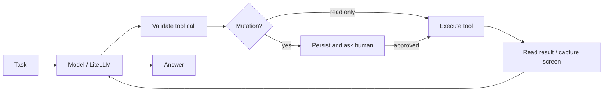

# GraphPilot

[](https://github.com/obsessed-star/graphpilot-agent/actions/workflows/ci.yml)


**A provider-neutral LangGraph agent that proposes tools, waits for approval, executes, and checks the result.**

Give it a workspace task or connect an Android phone over USB. The model chooses the next step; explicit Python code controls what can execute. Sessions and pending approvals survive restarts in SQLite.

The companion [USBPhone Control](https://github.com/obsessed-star/usbphone-control) repository implements the device transport. This project owns the reasoning loop, model adapter, tool registry and durable approval flow.



## Try it without a key or phone

Python 3.11+; commands below work in a terminal after activating your virtual environment.

```bash
git clone https://github.com/obsessed-star/graphpilot-agent.git
cd graphpilot-agent
python -m venv .venv
# Windows PowerShell: .\.venv\Scripts\Activate.ps1
# Linux/macOS: source .venv/bin/activate
python -m pip install -e ".[dev]"
python -m graphpilot.cli demo
```

The deterministic demo runs the **real LangGraph graph**, suspends before a write, resumes approval and verifies the resulting file. Its provider is scripted and makes zero network/model calls. It is a reproducible integration exercise, not a live AI demonstration.

## Run with Groq

Copy `.env.example` to `.env`, then save the key through a hidden terminal prompt:

```bash
python -m graphpilot.cli configure
python -m graphpilot.cli doctor
python -m graphpilot.cli run "Create a short task checklist in checklist.txt" --session checklist
```

The default is `groq/llama-3.3-70b-versatile`. No key belongs in source code, a command argument, an issue or a public screenshot. `doctor` reports presence only and does not call a model.

For Anthropic, Gemini, OpenAI, Ollama and compatible gateways, change `AGENT_MODEL` and provider environment variables. See [provider configuration](docs/providers.md). Compatibility depends on the selected model's tool/image support; live tests across every provider are not claimed.

## Connect the separate phone tool

Clone [USBPhone Control](https://github.com/obsessed-star/usbphone-control) next to this directory and install it into the same environment:

```bash
python -m pip install -e ../usbphone-control
python -m usbphone.cli devices
python -m graphpilot.cli run "Observe my phone and describe the visible screen" --phone --session phone-demo
```

Install official [Android Platform Tools](https://developer.android.com/tools/releases/platform-tools), enable USB debugging on your own phone and approve its RSA prompt yourself. Set `ADB_PATH` in `.env` if ADB is not on PATH. Set `ANDROID_SERIAL` when needed. Network ADB, emulators and iOS are excluded.

Text models receive UI labels and element coordinates. For screenshot reasoning, select a compatible vision model and enable `AGENT_VISION=true`. [Privacy and model requirements](docs/providers.md#groq-and-vision).

## Durable approval

File writes and phone actions require approval. Reads do not. To pause for review without an interactive prompt:

```bash
python -m graphpilot.cli run "Write a checklist in checklist.txt" --session review --non-interactive
# Inspect the proposed tool and its exact arguments, then choose ONE:
python -m graphpilot.cli resume approve --session review --non-interactive
python -m graphpilot.cli resume deny --session review --non-interactive
```

Use the same workspace/model/phone options when resuming. Phone captures expire after 30 seconds, so an old approved action is refused and the agent must observe again. Only one process should control a phone.

## Engineering choices

- **Explicit StateGraph:** model → validated tool → model, with conditional termination and SQLite checkpoints.
- **Provider boundary:** LiteLLM handles API translation; an injectable protocol isolates network behavior in tests.
- **Typed tools:** JSON Schema rejects unexpected arguments; file tools are restricted to a bounded task workspace.
- **Observable failure:** transport errors, denied actions and budget limits return evidence rather than a success claim.
- **Limited model spend:** no critic, hidden regeneration or automatic retries; per-invocation call/output/context limits.
- **Separate hardware layer:** the Android package works independently through Python, CLI or MCP.

## Verify

```bash
python -m pip install -r requirements-dev.lock
python -m pip install --no-deps -e .
ruff check .
ruff format --check .
python -m pytest -q
python -m build
```

The integration test uses the actual phone controller over a deterministic USB transport fixture. It skips when the companion package is absent. Local HTTP integration tests also run real CLI processes and the LiteLLM adapter through approval/resume and 401/429 failures, using scripted responses. CI includes a cross-repository integration job and Windows/Linux × Python 3.11/3.14 package checks. No API key or hardware is needed for CI. Use version 0.1.1 or newer; the [validation record](docs/validation.md) documents defects found after the initial unit-only preview.

[Architecture and tradeoffs](docs/architecture.md) · [Validation evidence](docs/validation.md) · [Security](SECURITY.md) · [Türkçe başlangıç](docs/tr.md)

## Current scope

This is a local, single-user pilot. Live Groq behavior and real USB-device control still require operator-provided credentials and hardware validation. Automated tests and scripted demos are identified as such. No hosted multi-user service, arbitrary PC shell, browser automation, autonomous purchase flow or distributed device locking is shipped.

Development uses AI assistance. Commits record actual implementation, tests and fixes in order; activity is not backdated.
