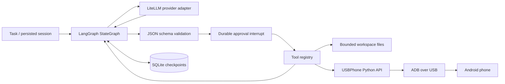

# Architecture and design decisions

## Boundaries

The model proposes actions. Python validates them. LangGraph stores the pending operation before a mutating tool can run. A human approves or denies that operation. Its result is sent back to the model for another decision. A maximum of one tool call is accepted per model turn; a batch is rejected without executing any of its calls.

### Why raw messages inside StateGraph?

The graph owns orchestration, state and suspension. LiteLLM owns provider-specific API translation. A small `Provider` protocol lets offline tests replace the network without replacing the real graph. This avoids depending on one model vendor's agent runtime. Tools use JSON Schema and a registry, not arbitrary Python evaluation or a shell.

### Why a separate phone repository?

Device selection, remote-shell quoting, observation IDs and dispatch semantics are transport concerns. USBPhone exposes the same controller to its Python, CLI and MCP interfaces. The agent integration is an adapter; the phone package has no LangGraph or model dependency.

### Approval and failure semantics

- File writes and all phone actions suspend via `langgraph.types.interrupt`.
- SQLite preserves pending approval across a process restart. Resuming with changed workspace/model/phone flags is refused.
- The phone controller consumes a capture ID before dispatch, including on timeouts. It does not replay a possibly executed input.
- `verified=true` means a post-action capture exists. The model must interpret that capture to establish whether the task succeeded.
- This is a single-process local pilot. Concurrent sessions can race over the same workspace/phone. Use one controller per device. There is no distributed transaction spanning Android and SQLite, and no exactly-once guarantee for arbitrary future tools.

### Budget behavior

One model request per reasoning turn; no critic, evaluator, hidden regeneration or automatic provider retries. Defaults: eight model requests, twelve tool executions, 1,024 output tokens and 24,000 text-context characters per invocation. Character accounting is a deterministic local guard, not an exact tokenizer estimate or a monetary spending cap. Tool schemas count toward the text guard. Images have a separate 5 MB ceiling; only the latest screenshot is forwarded. Historical checkpoints can still retain earlier image bytes locally.

### Extension points

Add a `Tool` with its JSON schema and `mutating` flag to the registry. Supply another `Provider.complete` implementation for a non-LiteLLM backend. Do not mark a mutating tool read-only to skip approval. For multi-user hosting, add authentication, per-user workspaces, encrypted storage, process/device locks and retention controls before exposing this runtime over a network.
